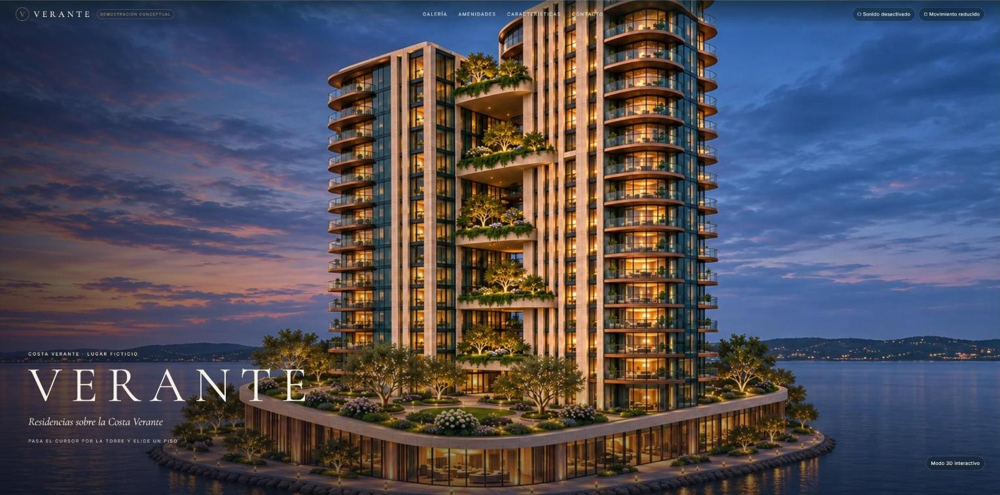
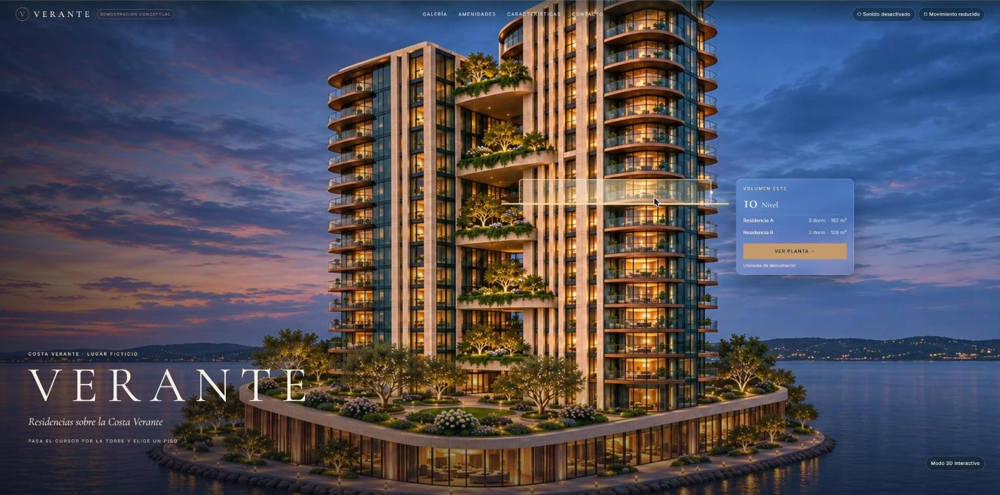
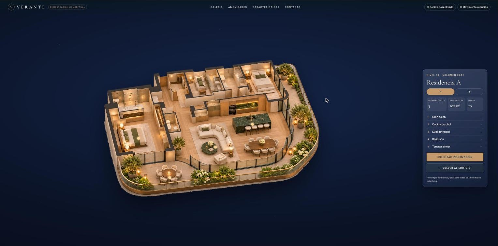
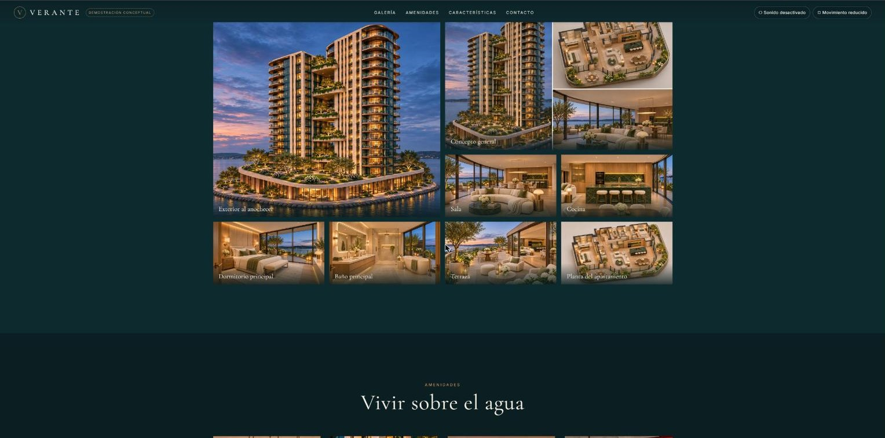
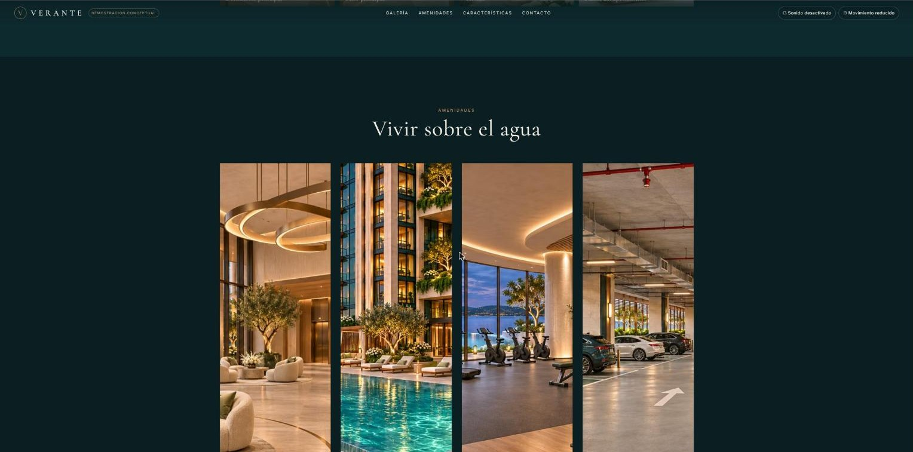

# VERANTE — Interactive 3D Luxury Real-Estate Website (Concept Demo)

> **Concept demo by ORVEXIA TECHNOLOGIES LLC.** VERANTE is a **fictional** residential project created to showcase what ORVEXIA can build for real-estate developers. It is not a real building, and no units are for sale.

## What it does

A cinematic, image-led sales website for a luxury waterfront tower, designed to feel like a launch film rather than a brochure:

- **Explore the tower floor by floor.** Hover the exterior and a glass card shows the level and its residences, linked by a glowing guide line.
- **Floor-plan reveal.** Click a level and the camera pushes in, the building falls away and the furnished floor plate floats in space. It tilts with the mouse.
- **Room-by-room tour.** Choose a room to dive into a full-screen interior with a slow Ken Burns move and a strip of thumbnails.
- **Optional interactive 3D mode.** A Three.js / React Three Fiber model of the towers that loads only when requested.
- **Gallery and amenities.** Lightbox gallery, lobby, infinity pool, gym and parking.
- **Lead capture.** A contact form with two separate, unchecked consent boxes plus a consent log.
- **Legal pages.** Privacy, terms, cookies, refunds, licenses and an image-disclosure page.

| Hover a level | Floor-plan reveal |
|---|---|
|  |  |

| Gallery | Amenities |
|---|---|
|  |  |

## Tech

React · Vite · Three.js · React Three Fiber · post-processing (bloom) · AVIF/WebP responsive images · lazy-loaded 3D bundle · accessible "reduced motion" and sound toggles.

## Notes

- The architectural and interior images are **AI-generated concept images** (created with ChatGPT). They do not show a real building.
- This repository is a **portfolio showcase**: screenshots and a description. The source code is private.

## Built by

**ORVEXIA TECHNOLOGIES LLC**, Sugar Land, Texas. Designed and developed by Ernys Nápoles.

- Website: https://orvexiatech.com
- Portfolio: https://orvexia.dev
- Want something like this for your project? https://orvexiatech.com/services

© 2026 ORVEXIA TECHNOLOGIES LLC. All rights reserved.
